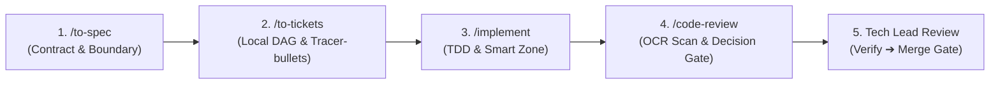

# AGENTS.md — k0maru-workspace Engineering & Workflow Constitution

This document defines the authoritative architecture, engineering discipline, and collaboration standards for AI agents (Antigravity, Claude Code, Cursor, Windsurf, etc.) operating on `k0maru-workspace`.

---

## 🧭 1. Context Pointers & System Glossary

Before modifying core modules or business logic, consult these primary sources of truth:
- **Domain Glossary**: [`CONTEXT.md`](CONTEXT.md) (Ubiquitous language, architecture seams, and domain invariants).
- **Project Vision & Roadmap**: [`PROJECT.md`](PROJECT.md) (System specs, quantitative assumptions, and Phase milestones).
- **Knowledge Core**: [[10_Projects/K0maru-Agent-Workspace]] in SecondBrain vault.

---

## 🎯 2. Delivery Loop & Dual-Tier Issue Tracking

Follow the strict specification-first delivery pipeline. No vibe coding.



1. **`/to-spec`**: Define API contracts, failure modes, boundary conditions, and testable Acceptance Criteria (DoD).
2. **`/to-tickets` & Dual-Tier Tracking**:
   - **L1 Macro Requirements (GitHub Issues)**: High-level features, bug reports, and epics live as GitHub Issues (`#NN`).
   - **L2 Micro Implementation (Local Tickets)**: Break specs into local tracer-bullet markdown tickets under `.scratch/k0maru-workspace/issues/<NN>-<slug>.md` with explicit `Blocked by` DAG dependencies.
   - **PR Linkage**: Completed feature PRs must reference the macro issue via `Closes #NN`.
3. **`/implement` (TDD in Smart Zone)**: Implement in isolated feature branches (`feat/*`). Write failing tests first, implement minimal passing code, then refactor.
4. **`/code-review` & Human Decision Gate**:
   - Automated pre-scan via OCR delegation mode covering Standards (Fowler smells & language safety) and Spec (DoD coverage).
   - Output executive briefing (<=15 lines) and prompt the human Tech Lead for the next action: (1) Directly submit PR, (2) Launch interactive `tuicr` guided walkthrough, (3) Auto-fix findings, or (4) Approve & merge PR.

---

## 🤖 3. Master-Worker Orchestration & Context Hygiene

Prevent context degradation and long-session amnesia (>100k tokens) through role separation:

1. **Master Orchestrator Agent**:
   - **Iron Law: Never write large blocks of production code directly in the main session.**
   - Focus on requirement clarification, architectural grilling, tickets DAG generation, and reviewing subagent deliverables.
2. **Worker Subagent (Implementor)**:
   - Spawn in clean 0-token context (`invoke_subagent` or fresh session).
   - Own one ticket at a time, execute TDD, run verification, commit, and exit.
3. **Human Engineer**:
   - Acts as **Tech Lead & Chief Architect** holding final approval and merge gates.

---

## 🌿 4. Git Branching & Promotion Discipline

Enforce dual-trunk isolation with deterministic merge strategies:

1. **`main` (Production Release Trunk)**:
   - Absolutely stable. **Direct push strictly forbidden.**
   - Accepts only milestone PRs from `dev` or signed semantic release tags (e.g. `v1.0.0`).
   - **Merge Strategy (Merge Commit)**: Merging `dev` into `main` MUST use standard merge commits (`git merge --no-ff`) to preserve milestone history and sprint topology. Never squash release PRs.
2. **`dev` (Integration Trunk)**:
   - Active integration target for all features and fixes. Must remain 100% green at all times.
   - **Merge Strategy (Squash & Merge)**: Merging feature branches into `dev` MUST use Squash & Merge to collapse iterative TDD micro-commits into a single clean semantic commit (`feat(scope): description`), keeping `dev` history linear.
3. **Feature Branches (`feat/*`, `fix/*`)**:
   - Branch off latest `dev`, implement in isolation, open PR to `dev` with Squash & Merge, then delete branch.
4. **Human Verification Gate (Anti-Rushing Rule)**:
   - Never auto-merge into `main` or cut releases without explicit human sign-off. Report results and let the human test on `dev` first.

---

## 🔏 5. Bot Attribution & Desensitization Iron Law

1. **Public Desensitization**:
   - Never hardcode personal bot names, App IDs, user IDs, or private emails into repository files.
   - Always probe the local environment dynamically:
     ```bash
     git config --get agent.coauthor
     ```
2. **Bot User ID Mapping**:
   - GitHub App bots require the numerical **Bot User ID** (from `api.github.com/users/<bot-name>[bot]`), NOT the App ID:
     `<bot_user_id>+<bot-name>[bot]@users.noreply.github.com`
3. **Dual-Mode Attribution**:
   - **Mode A (Default: Human Author + Bot Co-Author)**: Append trailer preceded by a blank line:
     `Co-authored-by: <bot-name>[bot] <<bot_user_id>+<bot-name>[bot]@users.noreply.github.com>`
   - **Mode B (Subagent Author)**: Explicit `git commit --author="<bot-name>[bot] <<bot_user_id>+<bot-name>[bot]@users.noreply.github.com>"` when designated.
   - If unconfigured, commit normally under local developer identity without third-party trailers.

---

## 📐 6. Quality Baselines & Testing Seams

1. **Toolchain & Commands**:
   - Language / Runtime: Rust 2021 (MSRV 1.75+)
   - Package Manager: cargo
   - Formatter: `cargo fmt --check`
   - Linter (Zero-Warning Gate): `cargo clippy --all-targets -- -D warnings`
   - Test Suite: `cargo test`
2. **Highest Observable Testing Seam**:
   - Write tests against the highest public abstraction seam (`WorkspaceManager` / CLI) asserting on external observables (filesystem state, git worktree list, exit codes) rather than brittle internal mocks.
3. **Zero Synthetic Fallback & Truth Invariants**:
   - Never fabricate synthetic mock data or fake git behaviors just to make tests green.
   - Run integration tests against real temporary Git repositories created via `tempfile::tempdir()`.

---

## ⚡ 7. Domain Invariants & Anti-Hardcoding Rules

1. **Single Source of Truth (SSOT)**:
   - Worktree states, paths, and branch metadata must be derived deterministically from `git worktree list --porcelain` and task identifiers.
2. **Zero Dirty-Write Concurrency**:
   - Agent tasks must never modify active developer working trees directly. All mutation must occur within isolated ephemeral worktrees.
3. **Atomic Teardown & Rollback Guarantee**:
   - Any aborted or failed worktree teardown must guarantee no orphaned git worktree lock, dangling branch, or undeleted directory remains.
4. **Deep Module Design**:
   - Simple, compact interfaces (`provision`, `teardown`, `prune_stale`) hiding complex multi-step process spawning and error classification.
