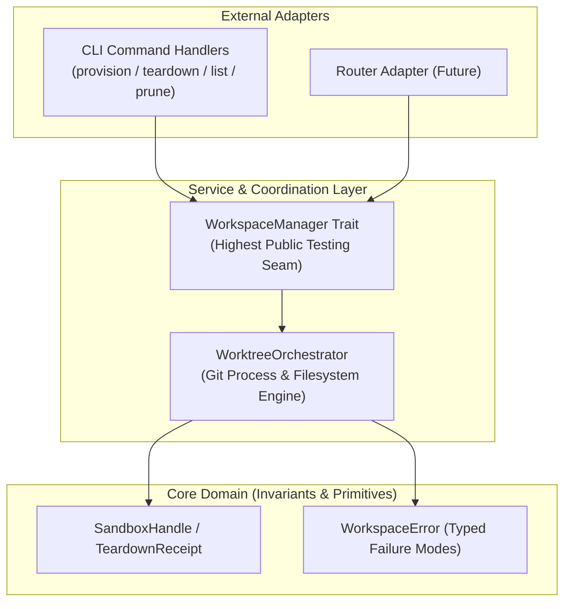

# CONTEXT.md — k0maru-workspace Domain Terminology & System Context

This document establishes the ubiquitous language, architectural seams, and domain invariants for `k0maru-workspace` to eliminate communication ambiguity between human engineers and AI agents.

---

## 🏛️ 1. System Vision & Scope

- **Core Vision**: The third modular cornerstone of the **K0maru-Harness** matrix (alongside `k0maru-agent-memory` and `k0maru-agent-router`). Provides lightweight, zero-overhead physical workspace isolation and ephemeral sandbox lifecycle management using native Git Worktrees.
- **Value Proposition**: Eliminates branch dirty-write race conditions between concurrent agents and human developers, prevents physical workspace file pollution, shares build caches safely, and automates sandbox cleanup and garbage collection.

---

## 📖 2. Domain Vocabulary

| Term | Symbol / Type | Authoritative Definition | Anti-Patterns & Common Misconceptions |
| :--- | :--- | :--- | :--- |
| **Workspace Provision Request** | `WorkspaceProvisionRequest` | Specification defining task ID, repository root, base branch, isolation strategy, and cache sharing rules | Never mutate request in flight; it is an immutable provision blueprint |
| **Sandbox Handle** | `SandboxHandle` | Value object containing isolated path, active branch name, and creation timestamp | Must not be confused with raw path strings; encapsulates isolation status |
| **Teardown Action** | `TeardownAction` | Explicit cleanup directive (`Merge`, `Abort`, `Retain`) | Never delete uncommitted work if action is Retain or when forensics are requested |
| **Teardown Receipt** | `TeardownReceipt` | Proof of worktree removal, branch deletion, or merge status | Always emit receipt upon teardown completion |
| **Prune Report** | `PruneReport` | Summary of stale or orphaned worktrees identified and pruned during GC | Must distinguish active leased sandboxes from orphaned ones |
| **Worktree Orchestrator** | `WorktreeOrchestrator` | Core engine executing git worktree primitives, branch creation, lock cleanup, and filesystem sanity | Never invoke git with arbitrary unvalidated shell strings |

---

## 🛡️ 3. Architecture Seams & Invariants

- **Domain Invariants**:
  - Ephemeral branches follow naming scheme `feat/task-<task_id>` or `fix/task-<task_id>`.
  - Ephemeral worktrees reside under `<repo_root>/.worktrees/<task_id>`.
  - Stale worktrees exceeding `max_age_secs` without active lease can be safely pruned.
- **Highest Testing Seam**:
  - All automated tests target `WorkspaceManager` and the CLI binary against real temporary git repositories created on disk.

---

## 📚 4. Reference Pointers

- Technical Specifications: [`PROJECT.md`](PROJECT.md)
- Agent Workflow Constitution: [`AGENTS.md`](AGENTS.md)
- SecondBrain Specification: `[[10_Projects/K0maru-Agent-Workspace]]`
