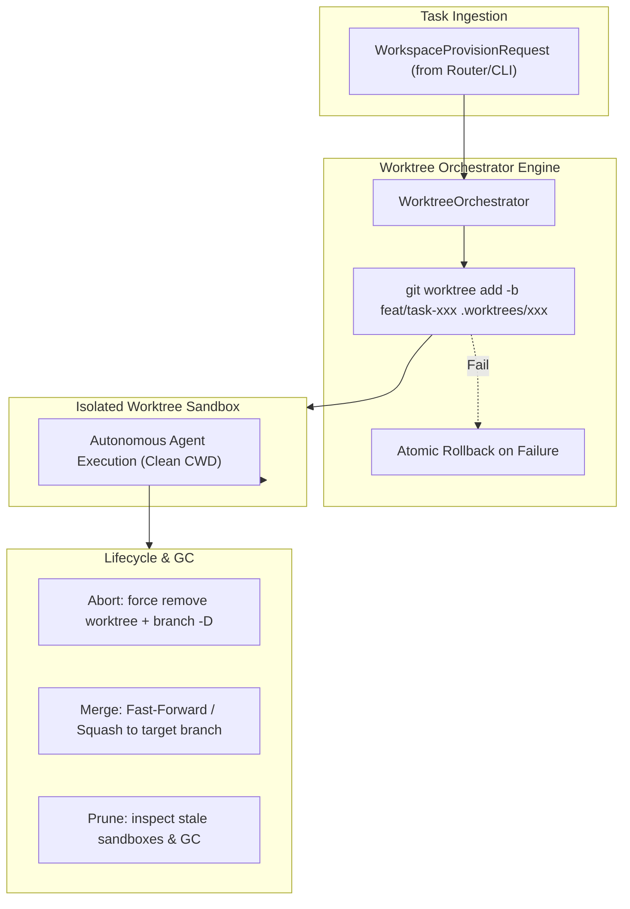

# K0maru Agent Workspace

[English](README.md) | [中文](README_CN.md)

> **Git Worktree Isolation & Ephemeral Sandbox Lifecycle Engine for AI Agents**  
> The 3rd modular cornerstone of the **K0maru-Harness** matrix (alongside `k0maru-agent-memory` and `k0maru-agent-router`).

---

## 🎯 Overview

When multiple AI coding agents (or human developers and agents) collaborate concurrently in the same repository, naive branch switching (`git checkout`) or in-place file modifications lead to severe workspace pollution, uncommitted work overwrites, and dirty-write race conditions.

**K0maru Agent Workspace** solves this by leveraging native **Git Worktrees** to provide lightweight, instant, isolated ephemeral physical execution sandboxes with zero code duplication and deterministic lifecycle management.



---

## ✨ Key Features

- ⚡ **Zero-Overhead Native Worktree Isolation**: Spawns isolated execution sandboxes in milliseconds using `git worktree add` without cloning repositories or duplicating git objects.
- 🛡️ **Zero Dirty-Write Concurrency**: Every task runs in its own directory (`.worktrees/<task_id>`) and ephemeral branch (`feat/task-<task_id>`), eliminating concurrency conflicts.
- 🔄 **Atomic Lifecycle Management**:
  - **Provision**: Validates task safety (prevents path traversal), sets up worktrees, and rolls back atomically if creation fails.
  - **Teardown**: Supports `abort` (clean rollback), `merge` (Squash or Fast-Forward into target branch), and `retain` (for debugging).
  - **Prune / GC**: Scans and garbage-collects orphaned or stale sandboxes exceeding a configured TTL.
- 🍏 **Cross-Platform & Symlink-Safe**: Immune to macOS `/var` vs `/private/var` symlink discrepancies through robust path component extraction.
- 🤖 **Dual-Interface**: Full Rust async library (`WorkspaceManager` trait) and CLI binary with both human-readable and `--json` outputs.

---

## 🚀 Quick Start (CLI)

### 1. Build from Source

```bash
cargo build --release
# Binary will be available at ./target/release/k0maru-workspace
```

### 2. Provision an Isolated Sandbox

```bash
k0maru-workspace provision --task-id task_01 --repo /path/to/repo --base dev
```
Output:
```text
Provisioned sandbox for task 'task_01':
  Workspace Path: /path/to/repo/.worktrees/task_01
  Branch:         feat/task-01
  Base Branch:    dev
```

### 3. List Active Sandboxes

```bash
k0maru-workspace list --repo /path/to/repo
```

### 4. Teardown a Sandbox

**Abort and clean up:**
```bash
k0maru-workspace teardown --task-id task_01 --repo /path/to/repo --action abort
```

**Merge changes to main/dev:**
```bash
k0maru-workspace teardown --task-id task_01 --repo /path/to/repo --action merge --target-branch dev --squash
```

### 5. Prune Stale Sandboxes (GC)

```bash
# Prune sandboxes older than 24 hours (default 86400s)
k0maru-workspace prune --repo /path/to/repo --max-age-secs 86400
```

> **Tip**: All commands support `--json` for automation and agent tool integration.

---

## 📦 Rust API Example

```rust
use k0maru_workspace::handle::{TeardownAction, WorkspaceProvisionRequest};
use k0maru_workspace::orchestrator::{WorkspaceManager, WorktreeOrchestrator};
use std::path::PathBuf;

#[tokio::main]
async fn main() -> anyhow::Result<()> {
    let repo_root = PathBuf::from("/path/to/repo");
    let orchestrator = WorktreeOrchestrator::new(&repo_root);

    // 1. Provision sandbox
    let req = WorkspaceProvisionRequest::new("task-42", &repo_root)
        .with_base_branch("dev");
    let handle = orchestrator.provision(&req).await?;
    println!("Sandbox ready at: {:?}", handle.workspace_path);

    // 2. Teardown (Merge into dev)
    let receipt = orchestrator
        .teardown(
            "task-42",
            TeardownAction::Merge {
                target_branch: "dev".into(),
                squash: true,
            },
        )
        .await?;
    println!("Teardown action: {}", receipt.action_taken);

    Ok(())
}
```

---

## 🧭 Project Roadmap

- [x] **Phase 1: Worktree Core & Atomic Lifecycle** (Current)
  - Worktree provision, rollback, list, teardown (merge/abort/retain), and prune GC.
  - CLI commands and 100% passing regression test suite.
- [ ] **Phase 2: Cache & Toolchain Sharing**
  - Shared symlinks for Cargo `target/`, Node `node_modules`, and Python venvs.
  - Custom environment (`.env`) and MCP server config injection.
- [ ] **Phase 3: Router & Multiplexer Integration**
  - Direct integration with `k0maru-agent-router` and Herdr/Tmux multiplexers.
- [ ] **Phase 4: Autonomous Verifier & Auto-Merge**
  - Automated test execution before merge gate.

---

## 🛡️ License

Apache-2.0 / MIT
