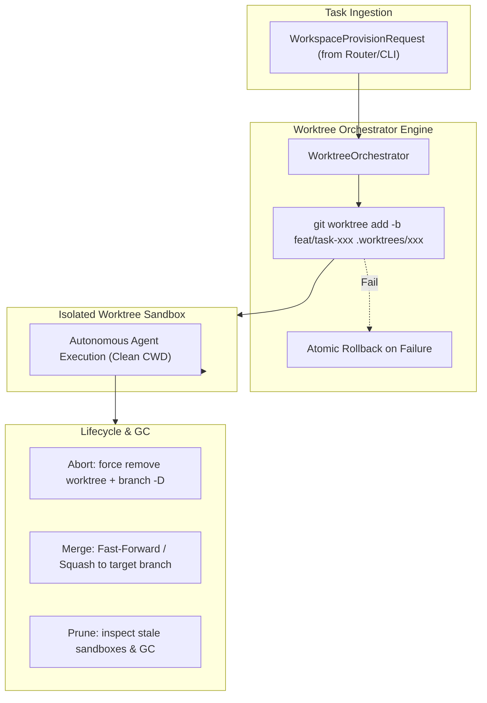

# K0maru Agent Workspace

[English](README.md) | [中文](README_CN.md)

> **Git Worktree Isolation & Ephemeral Sandbox Lifecycle Engine for AI Agents**  
> The 3rd modular cornerstone of the **K0maru-Harness** matrix (alongside `k0maru-agent-memory` and `k0maru-agent-router`).

---

## 🎯 Overview

When multiple AI coding agents (or human developers and agents) collaborate concurrently in the same repository, naive branch switching (`git checkout`) or in-place file modifications lead to severe workspace pollution, uncommitted work overwrites, and dirty-write race conditions.

**K0maru Agent Workspace** solves this by leveraging native **Git Worktrees** to provide lightweight, instant, isolated ephemeral physical execution sandboxes with zero code duplication and deterministic lifecycle management.



---

## ✨ Key Features

- ⚡ **Zero-Overhead Native Worktree Isolation**: Spawns isolated execution sandboxes in milliseconds using `git worktree add` without cloning repositories or duplicating git objects.
- 🛡️ **Zero Dirty-Write Concurrency**: Every task runs in its own directory (`.worktrees/<task_id>`) and ephemeral branch (`feat/task-<task_id>`), eliminating concurrency conflicts.
- 🔄 **Atomic Lifecycle Management**:
  - **Provision**: Validates task safety (prevents path traversal), sets up worktrees, and rolls back atomically if creation fails.
  - **Teardown**: Supports `abort` (clean rollback), `merge` (Squash or Fast-Forward into target branch), and `retain` (for debugging).
  - **Prune / GC**: Scans and garbage-collects orphaned or stale sandboxes exceeding a configured TTL.
- 🍏 **Cross-Platform & Symlink-Safe**: Immune to macOS `/var` vs `/private/var` symlink discrepancies through robust path component extraction.
- 🤖 **Dual-Interface**: Full Rust async library (`WorkspaceManager` trait) and CLI binary with both human-readable and `--json` outputs.

---

## 🚀 Quick Start (CLI)

### 1. Build from Source

```bash
cargo build --release
# Binary will be available at ./target/release/k0maru-workspace
```

### 2. Provision an Isolated Sandbox (with Caches & Configs)

```bash
k0maru-workspace provision \
  --task-id task_01 \
  --repo /path/to/repo \
  --base dev \
  --cache cargo \
  --cache node \
  --inject .env
```
Output:
```text
Provisioned sandbox for task 'task_01':
  Workspace Path: /path/to/repo/.worktrees/task_01
  Branch:         feat/task-01
  Base Branch:    dev
  Mounted Caches: [CargoTarget, NodeModules]
  Injected Files: [".env"]
```

### 3. List Active Sandboxes

```bash
k0maru-workspace list --repo /path/to/repo
```

### 4. Teardown a Sandbox

**Abort and clean up:**
```bash
k0maru-workspace teardown --task-id task_01 --repo /path/to/repo --action abort
```

**Merge changes to main/dev:**
```bash
k0maru-workspace teardown --task-id task_01 --repo /path/to/repo --action merge --target-branch dev --squash
```

### 5. Route TaskEnvelope from Router & Bind Multiplexer

```bash
# Ingest task envelope, provision sandbox, and generate Tmux/Herdr split command
k0maru-workspace route \
  --envelope envelope.json \
  --multiplexer herdr \
  --agent agy \
  --json
```

### 6. Verify Sandbox & Deterministic Auto-Merge Gate

Run physical test oracles (`cargo test`, `pytest`, `npm test`) inside the isolated sandbox. If all checks pass, optionally auto-merge the changes and prune the sandbox:

```bash
# Verify with custom test command, auto-merge on pass, and auto-rollback on fail
k0maru-workspace verify \
  --task-id task_01 \
  --repo /path/to/repo \
  --test-cmd "cargo test" \
  --linter-cmd "cargo clippy -- -D warnings" \
  --allowed-files "src/*,tests/*" \
  --auto-merge \
  --auto-rollback \
  --target-branch dev \
  --json
```

Output:
```json
{
  "$schema": "https://k0maru.dev/schemas/agent-receipt-v1.json",
  "task_id": "task_01",
  "workspace": "/path/to/repo/.worktrees/task_01",
  "verdict": "success",
  "checks": {
    "tests": {
      "status": "passed",
      "command": "cargo test",
      "exit_code": 0,
      "duration_ms": 1420
    },
    "linter": {
      "status": "passed",
      "command": "cargo clippy -- -D warnings",
      "exit_code": 0,
      "duration_ms": 860
    },
    "scope_guard": {
      "status": "passed",
      "modified_files": ["src/lib.rs", "tests/lib_test.rs"],
      "unauthorized_files": []
    }
  },
  "artifacts": {
    "git_patch_sha256": "4a7d189f76c5b0...",
    "receipt_timestamp": "2026-10-12T14:40:00Z"
  }
}
```

### 7. Prune Stale Sandboxes (GC)

```bash
# Prune sandboxes older than 24 hours (default 86400s)
k0maru-workspace prune --repo /path/to/repo --max-age-secs 86400
```

> **Tip**: All commands support `--json` for automation and agent tool integration.

---

## 📦 Rust API Example

```rust
use k0maru_workspace::handle::{CacheType, TeardownAction, WorkspaceProvisionRequest};
use k0maru_workspace::orchestrator::{WorkspaceManager, WorktreeOrchestrator};
use k0maru_workspace::router::{
    AgentType, MultiplexerType, RouterDispatchOptions, TaskEnvelope, WorkspaceRouterAdapter,
};
use k0maru_workspace::verifier::{VerifierConfig, WorkspaceVerifier};
use std::path::PathBuf;

#[tokio::main]
async fn main() -> anyhow::Result<()> {
    let repo_root = PathBuf::from("/path/to/repo");
    let orchestrator = WorktreeOrchestrator::new();

    // 1. Route task envelope directly from k0maru-agent-router
    let envelope: TaskEnvelope = serde_json::from_str(r#"{ ... }"#)?;
    let opts = RouterDispatchOptions {
        multiplexer: MultiplexerType::Tmux,
        agent: AgentType::Agy,
        ..Default::default()
    };
    let dispatch_receipt = WorkspaceRouterAdapter::dispatch(&envelope, opts).await?;
    println!("Sandbox provisioned at: {:?}", dispatch_receipt.sandbox_handle.workspace_path);

    // 2. Deterministic Verification & Auto-Merge Gate
    let config = VerifierConfig::builder()
        .test_command("cargo test")
        .linter_command("cargo clippy -- -D warnings")
        .auto_merge_on_pass(true)
        .target_branch("dev")
        .build();

    let (receipt, teardown) = WorkspaceVerifier::verify_sandbox(
        &repo_root,
        &envelope.task_id,
        &config,
        &orchestrator,
    ).await?;

    println!("Verification Verdict: {:?}", receipt.verdict);
    println!("SHA-256 Patch Digest: {:?}", receipt.artifacts.git_patch_sha256);

    Ok(())
}
```

---

## 🧭 Project Roadmap

- [x] **Phase 1: Worktree Core & Atomic Lifecycle**
  - Worktree provision, rollback, list, teardown (merge/abort/retain), and prune GC.
  - CLI commands and 100% passing regression test suite.
- [x] **Phase 2: Cache & Toolchain Sharing**
  - Shared symlinks for Cargo `target/`, Node `node_modules`, and Python venvs.
  - Safe unlinking on teardown to prevent parent repository cache corruption.
  - Custom environment (`.env`) and MCP server config injection.
- [x] **Phase 3: Router & Multiplexer Integration**
  - Direct integration with `k0maru-agent-router` via `agent-task-v1` `TaskEnvelope`.
  - Herdr & Tmux pane splitting and prompt injection command generation.
  - Automated cross-repo hotfix isolation.
- [x] **Phase 4: Autonomous Verifier & Auto-Merge Gate**
  - Deterministic physical test oracle (`agent-receipt-v1.json` compliance).
  - Scope guard verifying modified files against authorized whitelists.
  - SHA-256 patch fingerprinting and automated atomic merge on zero-exit-code verification.

---

## 🛡️ License

Apache-2.0 / MIT

