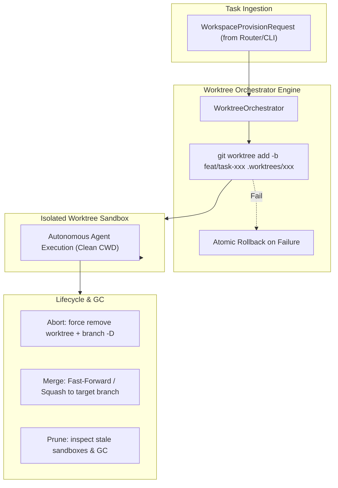

# K0maru Agent Workspace

[English](README.md) | [中文](README_CN.md)

> **Git Worktree Isolation & Ephemeral Sandbox Lifecycle Engine for AI Agents**  
> The 3rd modular cornerstone of the **K0maru-Harness** matrix (alongside `k0maru-agent-memory` and `k0maru-agent-router`).

---

## 🎯 Overview

When multiple AI coding agents (or human developers and agents) collaborate concurrently in the same repository, naive branch switching (`git checkout`) or in-place file modifications lead to severe workspace pollution, uncommitted work overwrites, and dirty-write race conditions.

**K0maru Agent Workspace** solves this by leveraging native **Git Worktrees** to provide lightweight, instant, isolated ephemeral physical execution sandboxes with zero code duplication and deterministic lifecycle management.



---

## ✨ Key Features

- ⚡ **Zero-Overhead Native Worktree Isolation**: Spawns isolated execution sandboxes in milliseconds using `git worktree add` without cloning repositories or duplicating git objects.
- 🛡️ **Zero Dirty-Write Concurrency**: Every task runs in its own directory (`.worktrees/<task_id>`) and ephemeral branch (`feat/task-<task_id>`), eliminating concurrency conflicts.
- 🔄 **Atomic Lifecycle Management**:
  - **Provision**: Validates task safety (prevents path traversal), sets up worktrees, and rolls back atomically if creation fails.
  - **Teardown**: Supports `abort` (clean rollback), `merge` (Squash or Fast-Forward into target branch), and `retain` (for debugging).
  - **Prune / GC**: Scans and garbage-collects orphaned or stale sandboxes exceeding a configured TTL.
- 🍏 **Cross-Platform & Symlink-Safe**: Immune to macOS `/var` vs `/private/var` symlink discrepancies through robust path component extraction.
- 🤖 **Dual-Interface**: Full Rust async library (`WorkspaceManager` trait) and CLI binary with both human-readable and `--json` outputs.

---

## 🚀 Quick Start (CLI)

### 1. Build from Source

```bash
cargo build --release
# Binary will be available at ./target/release/k0maru-workspace
```

### 2. Provision an Isolated Sandbox (with Caches & Configs)

```bash
k0maru-workspace provision \
  --task-id task_01 \
  --repo /path/to/repo \
  --base dev \
  --cache cargo \
  --cache node \
  --inject .env
```
Output:
```text
Provisioned sandbox for task 'task_01':
  Workspace Path: /path/to/repo/.worktrees/task_01
  Branch:         feat/task-01
  Base Branch:    dev
  Mounted Caches: [CargoTarget, NodeModules]
  Injected Files: [".env"]
```

### 3. List Active Sandboxes

```bash
k0maru-workspace list --repo /path/to/repo
```

### 4. Teardown a Sandbox

**Abort and clean up:**
```bash
k0maru-workspace teardown --task-id task_01 --repo /path/to/repo --action abort
```

**Merge changes to main/dev:**
*(Note: Pre-merge quality verification and test oracle execution are delegated to `k0maru-verifier`)*
```bash
k0maru-workspace teardown --task-id task_01 --repo /path/to/repo --action merge --target-branch dev --squash
```

### 5. Route TaskEnvelope from Router & Bind Multiplexer

```bash
# Ingest task envelope, provision sandbox, and generate Tmux/Herdr split command
k0maru-workspace route \
  --envelope envelope.json \
  --multiplexer herdr \
  --agent agy \
  --json
```

### 6. Prune Stale Sandboxes (GC)

```bash
# Prune sandboxes older than 24 hours (default 86400s)
k0maru-workspace prune --repo /path/to/repo --max-age-secs 86400
```

> **Tip**: All commands support `--json` for automation and agent tool integration.

---

## ⚖️ Quality Gate & Verification Delegation

In adherence to the Unix philosophy and the modular **K0maru-Harness** architecture:
- `k0maru-agent-workspace` focuses strictly on **sandbox lifecycle management** (`provision`, `teardown`, `list`, `prune`, `route`).
- Deterministic physical test oracle execution, scope guard checking, and `agent-receipt-v1.json` immutable receipt signing are delegated to the standalone [`k0maru-agent-verifier`](https://github.com/K0maru/k0maru-agent-verifier) CLI.
- Standard flow:
  ```mermaid
  flowchart LR
      Router["k0maru-router"] --> Provision["workspace provision / route"]
      Provision --> Agent["Agent Implements in Sandbox"]
      Agent --> Verifier["k0maru-verifier (Exit Code & Scope Guard)"]
      Verifier --> Merge["workspace teardown --action merge"]
  ```

---

## 📦 Rust API Example

```rust
use k0maru_workspace::handle::{CacheType, IsolationStrategy, TeardownAction, WorkspaceProvisionRequest};
use k0maru_workspace::orchestrator::{WorkspaceManager, WorktreeOrchestrator};
use k0maru_workspace::router::{
    AgentType, MultiplexerType, RouterDispatchOptions, TaskEnvelope, WorkspaceRouterAdapter,
};
use std::path::PathBuf;

#[tokio::main]
async fn main() -> anyhow::Result<()> {
    let repo_root = PathBuf::from("/path/to/repo");
    let orchestrator = WorktreeOrchestrator::new(&repo_root);

    // 1. Provision an isolated worktree sandbox
    let req = WorkspaceProvisionRequest::new("task-01", &repo_root)
        .with_base_branch("dev")
        .with_strategy(IsolationStrategy::Worktree)
        .with_caches(vec![CacheType::CargoTarget, CacheType::NodeModules])
        .with_injected_configs(vec![".env".to_string()]);

    let handle = orchestrator.provision(&req).await?;
    println!("Sandbox provisioned at: {:?}", handle.workspace_path);

    // 2. Perform work in handle.workspace_path (verified via k0maru-verifier)

    // 3. Teardown and merge after verification passes
    let receipt = orchestrator
        .teardown(
            &handle.task_id,
            TeardownAction::Merge {
                target_branch: "dev".to_string(),
                squash: true,
                force: false,
            },
        )
        .await?;

    println!("Teardown complete: action={}", receipt.action_taken);

    Ok(())
}
```

---

## 🧭 Project Roadmap

- [x] **Phase 1: Worktree Core & Atomic Lifecycle**
  - Worktree provision, rollback, list, teardown (merge/abort/retain), and prune GC.
  - CLI commands and 100% passing regression test suite.
- [x] **Phase 2: Cache & Toolchain Sharing**
  - Shared symlinks for Cargo `target/`, Node `node_modules`, and Python venvs.
  - Safe unlinking on teardown to prevent parent repository cache corruption.
  - Custom environment (`.env`) and MCP server config injection.
- [x] **Phase 3: Router & Multiplexer Integration**
  - Direct integration with `k0maru-agent-router` via `agent-task-v1` `TaskEnvelope`.
  - Herdr & Tmux pane splitting and prompt injection command generation.
  - Automated cross-repo hotfix isolation.
- [x] **Phase 4: Quality Gate Delegation & Harness Boundary**
  - Decoupled physical test oracle execution to standalone `k0maru-agent-verifier`.
  - Kept workspace engine lean and focused strictly on ephemeral sandbox lifecycle.
- [x] **Phase 5: Multi-Strategy Isolation & In-Place Passthrough**
  - `InPlace` zero-overhead direct passthrough for read-only exploration with safe no-op teardown.
  - `TempDir` ephemeral filesystem directory isolation for non-git scratch scripts.
  - Automated strategy deduction in `WorkspaceRouterAdapter` based on task envelope tags (`read_only`, `in_place`, `query`).

---

## 🛡️ License

Apache-2.0 / MIT

