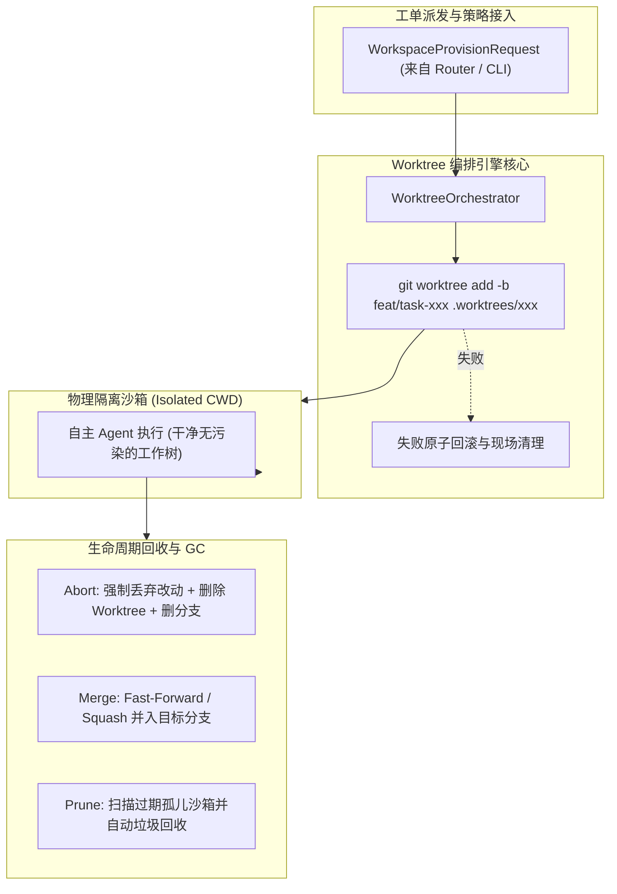

# K0maru Agent Workspace (智能体工作区隔离与沙箱生命周期引擎)

[English](README.md) | [中文](README_CN.md)

> **基于 Git Worktree 的智能体物理隔离与沙箱生命周期引擎**  
> **K0maru-Harness** 矩阵第三块核心积木（与 `k0maru-agent-memory` 认知中枢、`k0maru-agent-router` 寻址中枢深度协同）。

---

## 🎯 痛点与定位

在多智能体（Multi-Agent）并发协作或人机结对编码场景中，若直接在当前主工作区执行 `git checkout` 或修改文件，极易造成未提交工作冲毁、文件污染及分支脏写竞争（Dirty-Write Concurrency）。

**K0maru Agent Workspace** 原生基于 **Git Worktree** 技术，为并发 Agent 提供轻量、秒级就绪的物理隔离执行沙箱，实现零代码冗余克隆开销与确定性的沙箱生命周期管理。



---

## ✨ 核心特性

- ⚡ **原生 Git Worktree 物理隔离**：毫秒级创建任务专属沙箱，共享底层 `.git` 对象库，零全量 Clone 磁盘开销。
- 🛡️ **彻底破除脏写竞争**：每个任务严格运行在 `.worktrees/<task_id>` 独立物理路径及 `feat/task-<task_id>` 临时分支下。
- 🔄 **原子级生命周期管理**：
  - **创建（Provision）**：内置安全校验（严防 `..` 路径穿越），失败时自动原子回滚清理残余，杜绝孤儿沙箱。
  - **销毁（Teardown）**：支持 `abort`（安全回滚撤销）、`merge`（Squash 或 Fast-Forward 快速合并）、`retain`（现场留存取证调试）。
  - **清理（Prune / GC）**：支持基于 TTL 巡检并自动清理超时未释放的悬空工作区。
- 🍏 **跨平台与符号链接免疫**：基于路径组件解析，免疫 macOS `/var` 与 `/private/var` 符号链接歧义。
- 🤖 **双接口支持**：提供 Rust 异步库抽象（`WorkspaceManager` Trait）与标准 CLI 工具，支持终端可读与 `--json` 机器格式双输出。

---

## 🚀 CLI 快速上手

### 1. 编译安装

```bash
cargo build --release
# 生成的可执行文件位于 ./target/release/k0maru-workspace
```

### 2. 创建隔离沙箱（支持缓存挂载与配置注入）

```bash
k0maru-workspace provision \
  --task-id task_01 \
  --repo /path/to/repo \
  --base dev \
  --cache cargo \
  --cache node \
  --inject .env
```
输出示例：
```text
Provisioned sandbox for task 'task_01':
  Workspace Path: /path/to/repo/.worktrees/task_01
  Branch:         feat/task-01
  Base Branch:    dev
  Mounted Caches: [CargoTarget, NodeModules]
  Injected Files: [".env"]
```

### 3. 查看活跃沙箱列表

```bash
k0maru-workspace list --repo /path/to/repo
```

### 4. 回收与清理沙箱

**放弃改动并强力清理：**
```bash
k0maru-workspace teardown --task-id task_01 --repo /path/to/repo --action abort
```

**测试通过并合并至主干：**
```bash
k0maru-workspace teardown --task-id task_01 --repo /path/to/repo --action merge --target-branch dev --squash
```

### 5. 联动 Router 工单与多路复用器分屏

```bash
# 接收 Router 下发的 TaskEnvelope，自动配发 Worktree 并生成分屏指令
k0maru-workspace route \
  --envelope envelope.json \
  --multiplexer herdr \
  --agent agy \
  --json
```

### 6. 巡检过期孤儿沙箱 (GC)

```bash
# 清理超过 24 小时未释放的沙箱（默认 86400 秒）
k0maru-workspace prune --repo /path/to/repo --max-age-secs 86400
```

> **提示**：所有命令均支持 `--json` 参数，便于自动化脚本及 Agent 协议接入。

---

## 📦 Rust API 使用示例

```rust
use k0maru_workspace::handle::{CacheType, TeardownAction, WorkspaceProvisionRequest};
use k0maru_workspace::orchestrator::{WorkspaceManager, WorktreeOrchestrator};
use k0maru_workspace::router::{
    AgentType, MultiplexerType, RouterDispatchOptions, TaskEnvelope, WorkspaceRouterAdapter,
};
use std::path::PathBuf;

#[tokio::main]
async fn main() -> anyhow::Result<()> {
    let repo_root = PathBuf::from("/path/to/repo");

    // 1. 直接路由并消费来自 k0maru-agent-router 的任务工单
    let envelope: TaskEnvelope = serde_json::from_str(r#"{ ... }"#)?;
    let opts = RouterDispatchOptions {
        multiplexer: MultiplexerType::Herdr,
        agent: AgentType::Agy,
        ..Default::default()
    };
    let receipt = WorkspaceRouterAdapter::dispatch(&envelope, opts).await?;
    println!("沙箱已就绪: {:?}", receipt.sandbox_handle.workspace_path);
    println!("窗格启动指令: {:?}", receipt.multiplexer_command);

    Ok(())
}
```

---

## 🧭 路线图规划

- [x] **Phase 1: Worktree 核心与原子生命周期**
  - 原生 Worktree 配发、回滚、查询、Teardown（merge/abort/retain）及 Prune GC。
  - CLI 工具落地与 100% 通过的自动化回归测试。
- [x] **Phase 2: 缓存与工具链智能共享**
  - Cargo `target/`、Node `node_modules`、Python `.venv` 智能软链复用。
  - 任务专有 `.env` 与 MCP 配置注入，主仓环境只读防污染。
  - 安全解绑（cleanup mounts），严防 Worktree 销毁时误删主仓缓存。
- [x] **Phase 3: Router 与终端多路复用器联动**（当前阶段）
  - 深度联动 `k0maru-agent-router`，支持原生 `agent-task-v1` `TaskEnvelope` 工单路由。
  - Herdr & Tmux 窗格自动切分与 Agent 唤醒指令生成。
  - 闭环验证跨仓 Bug 隔离热修复。
- [ ] **Phase 4: 确定性验证器与自动合入**
  - 结合 `k0maru-agent-verifier` 实现测试通过后自动合入。

---

## 🛡️ 开源协议

Apache-2.0 / MIT
