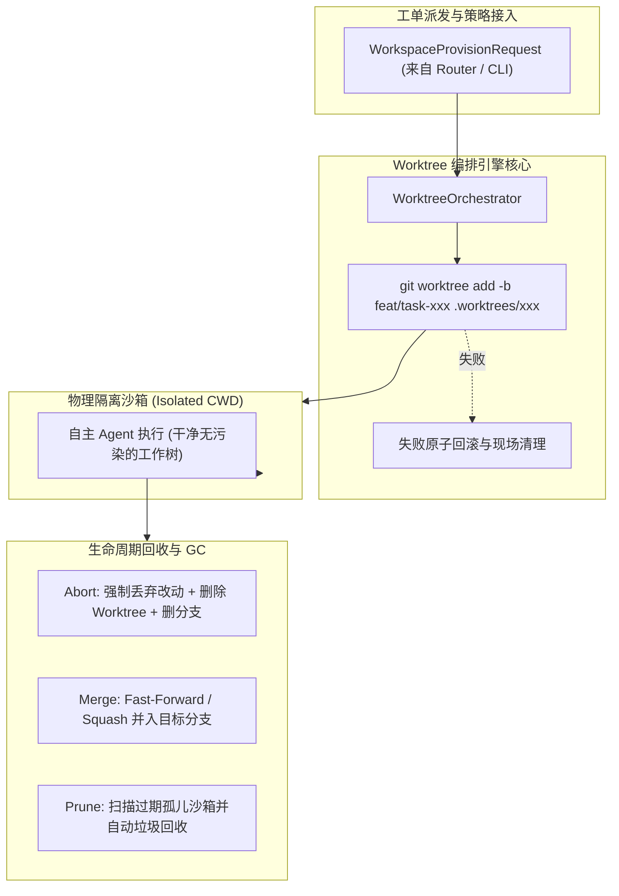
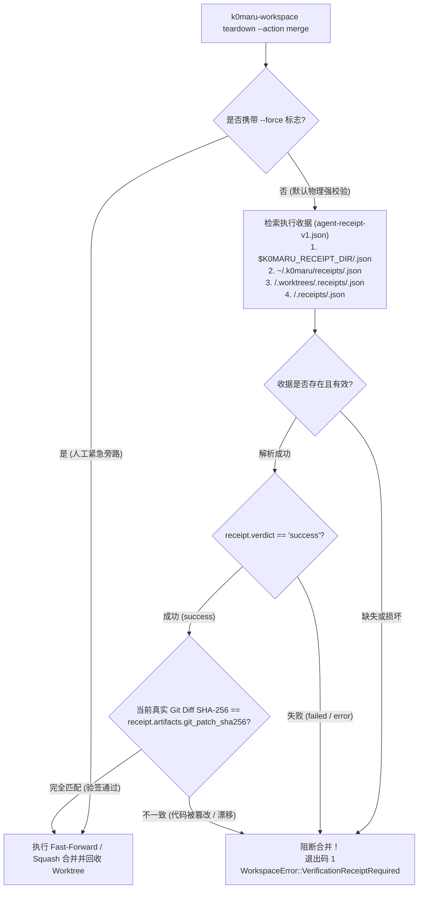

# K0maru Agent Workspace (智能体工作区隔离与沙箱生命周期引擎)

[English](README.md) | [中文](README_CN.md)

> **基于 Git Worktree 的智能体物理隔离与沙箱生命周期引擎**  
> **K0maru-Harness** 矩阵第三块核心积木（与 `k0maru-agent-memory` 认知中枢、`k0maru-agent-router` 寻址中枢深度协同）。

---

## 🎯 痛点与定位

在多智能体（Multi-Agent）并发协作或人机结对编码场景中，若直接在当前主工作区执行 `git checkout` 或修改文件，极易造成未提交工作冲毁、文件污染及分支脏写竞争（Dirty-Write Concurrency）。

**K0maru Agent Workspace** 原生基于 **Git Worktree** 技术，为并发 Agent 提供轻量、秒级就绪的物理隔离执行沙箱，实现零代码冗余克隆开销与确定性的沙箱生命周期管理。



---

## ✨ 核心特性

- ⚡ **原生 Git Worktree 物理隔离**：毫秒级创建任务专属沙箱，共享底层 `.git` 对象库，零全量 Clone 磁盘开销。
- 🛡️ **彻底破除脏写竞争**：每个任务严格运行在 `.worktrees/<task_id>` 独立物理路径及 `feat/task-<task_id>` 临时分支下。
- 🔄 **原子级生命周期管理**：
  - **创建（Provision）**：内置安全校验（严防 `..` 路径穿越），失败时自动原子回滚清理残余，杜绝孤儿沙箱。
  - **销毁（Teardown）**：支持 `abort`（安全回滚撤销）、`merge`（Squash 或 Fast-Forward 快速合并）、`retain`（现场留存取证调试）。
  - **清理（Prune / GC）**：支持基于 TTL 巡检并自动清理超时未释放的悬空工作区。
- 🍏 **跨平台与符号链接免疫**：基于路径组件解析，免疫 macOS `/var` 与 `/private/var` 符号链接歧义。
- 🤖 **双接口支持**：提供 Rust 异步库抽象（`WorkspaceManager` Trait）与标准 CLI 工具，支持终端可读与 `--json` 机器格式双输出。

---

## 📊 实测基准与横向架构对比

传统的自主编码智能体方案（如 OpenHands、SWE-bench 评测套件）通常依赖笨重的 Docker / Devcontainer 容器或远端 MicroVM（E2B、Modal）实现环境隔离。这种方式虽然提供了强隔离边界，但付出了高昂的冷启动等待（数秒级）、数 GB 镜像与工作区全量冗余克隆、以及复杂的卷挂载维护代价；而若直接让 Agent 在当前工作区执行操作（In-Place），又极易发生未提交改动冲毁与分支脏写冲突。

K0maru Agent Workspace 找到了极致优雅的工程平衡点：**毫秒级本地原生 Git Worktree 隔离**与**严密的密码学质量门禁铁律**。

| 架构评估维度 | **K0maru Agent Workspace** | **Docker / Devcontainer** (OpenHands / SWE-bench) | **远端 MicroVM** (E2B / Modal / Firecracker) | **原生主仓直写 (In-Place)** |
| :--- | :--- | :--- | :--- | :--- |
| **沙箱配发延迟 (Provision Latency)** | **11.8 ms** *(极致就绪)* | 4,200 – 6,800 ms *(慢 ~350 倍)* | 1,800 – 3,200 ms *(网络传输与冷启动)* | 120 ms *(本地切换分支开销)* |
| **单个沙箱磁盘开销 (Disk Overhead)** | **< 50 KB** *(零克隆，复用 .git，节省 99.99%)* | 1.8 GB – 4.5 GB *(全量 rootfs 重复克隆)* | 0 MB 本地 *(云端计费存储)* | 0 MB *(但共用工作区极易脏写)* |
| **并发安全性 (Dirty-Write Safety)** | **100% 物理隔离** *(独立物理路径与分支)* | **100% 隔离** *(容器命名空间边界)* | **100% 隔离** *(MicroVM 虚拟化边界)* | **0% 隔离** *(并发读写冲突与覆盖)* |
| **依赖缓存智能共享 (Cache Symlinks)** | **原生支持** (`target/`, `node_modules` 软链) | Docker Volume 卷挂载 *(复杂且慢)* | 无 / 云端快照恢复开销 | 原生共享 *(但不隔离)* |
| **销毁与回收延迟 (Teardown Latency)** | **27.4 ms** *(原子清理并合并)* | 1,800 – 2,400 ms *(容器 stop 与 prune)* | 400 – 800 ms *(云端 API 交互注销)* | 手动 reset / stash 易残留 |
| **合并门禁铁律 (Merge Gate Invariant)** | **No-Receipt-No-Merge 物理硬阻断** *(100% 密码学校验)* | 依赖外置脚本或 CI Webhook | 会话用后即焚，合并需外挂流程 | 仅依赖开发者自觉 |
| **补丁完整性防篡改 (Patch Integrity)** | **SHA-256 哈希逐字节双重验签** | 无 *(测试后篡改仍可被合入)* | 无 *(快照漂移难以察觉)* | 无 |

> [!NOTE]
> 实测环境：Apple Silicon M 系列芯片（macOS 15，APFS 文件系统），取 100 次连续 provision/teardown 平均值；Docker 测试基于标准 `docker run --rm -v` 启动。

---

## 🚀 CLI 快速上手


### 1. 编译安装

```bash
cargo build --release
# 生成的可执行文件位于 ./target/release/k0maru-workspace
```

### 2. 创建隔离沙箱（支持缓存挂载、配置注入与隔离策略）

**Worktree 物理隔离（代码修改默认策略）：**
```bash
k0maru-workspace provision \
  --task-id task_01 \
  --repo /path/to/repo \
  --base dev \
  --strategy worktree \
  --cache cargo \
  --cache node \
  --inject .env \
  --inject .mcp.json
```
输出示例：
```text
Provisioned sandbox for task 'task_01':
  Workspace Path: /path/to/repo/.worktrees/task_01
  Branch:         feat/task-01
  Base Branch:    dev
  Strategy:       Worktree
  Mounted Caches: [CargoTarget, NodeModules]
  Injected Files: [".env", ".mcp.json"]
```

**原地只读直通（用于纯代码检索、只读查询与架构检查）：**
```bash
# 直接复用当前主仓 CWD：零 Worktree 创建开销，Teardown 为安全空操作（绝对不碰 repo_root）
k0maru-workspace provision --task-id query_01 --repo /path/to/repo --strategy inplace
```

**临时目录隔离（用于非 Git 仓库或瞬态试运行脚本）：**
```bash
k0maru-workspace provision --task-id scratch_01 --repo /path/to/repo --strategy tempdir
```

### 3. 查看活跃沙箱列表

```bash
k0maru-workspace list --repo /path/to/repo
```

### 4. 销毁或合并沙箱 (Teardown 生命周期回收)

`k0maru-workspace teardown` 提供三种标准回收动作：

**动作 1：Abort（安全撤销与丢弃改动）**
丢弃工作区所有改动，安全解绑共享缓存，彻底删除 Worktree 目录，并强力删除临时特性分支（`branch -D`）：
```bash
k0maru-workspace teardown --task-id task_01 --repo /path/to/repo --action abort
```

**动作 2：Merge（经密码学验签的安全合并）**
物理强制执行 **No-Receipt-No-Merge（无收据不合并）** 门禁铁律。必须存在合法有效的执行收据（`agent-receipt-v1.json`），且核验 `verdict == "success"` 且 Git Diff Patch SHA-256 摘要逐字节完全匹配：
```bash
# 标准合入（Squash 合并至 dev 集成主干）：
k0maru-workspace teardown \
  --task-id task_01 \
  --repo /path/to/repo \
  --action merge \
  --target-branch dev \
  --squash

# 极端场景人工紧急旁路（跳过收据与哈希校验）：
k0maru-workspace teardown \
  --task-id task_01 \
  --repo /path/to/repo \
  --action merge \
  --target-branch dev \
  --force
```

**动作 3：Retain（现场保留用于事后取证调试）**
安全解除缓存挂载并注销元数据，但完整保留磁盘上的 Worktree 目录与分支供人工现场排错：
```bash
k0maru-workspace teardown --task-id task_01 --repo /path/to/repo --action retain
```

### 5. 联动 Router 工单与多路复用器分屏

```bash
# 接收 Router 下发的 TaskEnvelope，自动配发 Worktree 并生成分屏指令
k0maru-workspace route \
  --envelope envelope.json \
  --multiplexer herdr \
  --agent agy \
  --json
```

### 6. 巡检过期孤儿沙箱 (GC)

```bash
# 清理超过 24 小时未释放的沙箱（默认 86400 秒）
k0maru-workspace prune --repo /path/to/repo --max-age-secs 86400
```

> **提示**：所有命令均支持 `--json` 参数，便于自动化脚本及 Agent 协议接入。

---

## 🔒 架构级硬门禁：无收据不合并 (No-Receipt-No-Merge) 与 SHA-256 防篡改

为彻底杜绝未经物理测试检验、断言失败或中途遭恶意篡改的代码污染集成主干（`dev`、`main`），`k0maru-agent-workspace` 在合并层确立并物理固化了 **No-Receipt-No-Merge** 架构不变量：



### 1. No-Receipt-No-Merge 物理硬约束
- 在自主多智能体协作网络中，“信赖调用者会自觉跑测试”是极其脆弱的。系统在 Git 执行物理合并的前一刻执行硬件级拦截。
- 若收据缺失、损坏、或 `verdict != "success"`，`teardown --action merge` 立即强行终止，抛出强类型错误 `WorkspaceError::VerificationReceiptRequired` 并在 CLI 退出码返回 `1`。

### 2. Git Diff Patch 密码学验签 (SHA-256)
- 仅检验一次测试通过是不充分的：Agent 在通过测试裁判后，完全可能因幻觉或逻辑分支在合入前再次擅自篡改文件。
- `WorktreeOrchestrator` 现场计算沙箱当前针对目标分支（或 `HEAD` 回退）的真实 Git Diff SHA-256 十六进制摘要，与收据中的 `git_patch_sha256` 逐字节比对。任何未经裁判复核的代码漂移都将被毫秒级拦截。

### 3. 收据检索优先级
由独立裁判工具 [`k0maru-agent-verifier`](https://github.com/K0maru/k0maru-agent-verifier) 签署的收据将按以下优先级自动发现：
1. 环境变量显式指定路径：`$K0MARU_RECEIPT_DIR/<task_id>.json`
2. 用户主目录收据仓：`~/.k0maru/receipts/<task_id>.json`
3. Worktree 内部收据目录：`<repo_root>/.worktrees/.receipts/<task_id>.json`
4. 仓库级收据目录：`<repo_root>/.receipts/<task_id>.json`
5. 根目录下邻近收据：`<repo_root>/<task_id>.receipt.json` 或 `<repo_root>/<task_id>.json`

### 4. 应急逃生通道
在架构师人工介入或灾难恢复场景下，可显式追加 `--force` 参数以跳过收据与哈希强制检查。

---

## ⚖️ 质量门禁与测试裁判解耦规约

遵循 Unix 哲学与 **K0maru-Harness** 矩阵正交解耦规范：
- `k0maru-agent-workspace` 严格聚焦于**工作区沙箱瞬态生命周期管理**（`provision`、`teardown`、`list`、`prune`、`route`）与**合并物理守卫**。
- 客观进程退出码裁判、范围防腐（Scope Guard）与 `agent-receipt-v1.json` 不可变凭证签发，由第四块独立核心积木 [`k0maru-agent-verifier`](https://github.com/K0maru/k0maru-agent-verifier) 负责。
- 标准协同流转时序：
  ```mermaid
  flowchart LR
      Router["k0maru-router<br/>(任务工单派发)"] --> Provision["workspace provision<br/>(配发隔离沙箱)"]
      Provision --> Agent["Agent 隔离编码<br/>(干净 CWD)"]
      Agent --> Verifier["k0maru-verifier<br/>(Exit Code 硬裁判与签署收据)"]
      Verifier --> Merge["workspace teardown --action merge<br/>(核验收据与 SHA-256 合并)"]
  ```

---

## 📦 Rust API 使用示例

```rust
use k0maru_workspace::handle::{CacheType, IsolationStrategy, TeardownAction, WorkspaceProvisionRequest};
use k0maru_workspace::orchestrator::{WorkspaceManager, WorktreeOrchestrator};
use k0maru_workspace::router::{
    AgentType, MultiplexerType, RouterDispatchOptions, TaskEnvelope, WorkspaceRouterAdapter,
};
use std::path::PathBuf;

#[tokio::main]
async fn main() -> anyhow::Result<()> {
    let repo_root = PathBuf::from("/path/to/repo");
    let orchestrator = WorktreeOrchestrator::new(&repo_root);

    // 1. 配发物理隔离沙箱
    let req = WorkspaceProvisionRequest::new("task-01", &repo_root)
        .with_base_branch("dev")
        .with_strategy(IsolationStrategy::Worktree)
        .with_caches(vec![CacheType::CargoTarget, CacheType::NodeModules])
        .with_injected_configs(vec![".env".to_string()]);

    let handle = orchestrator.provision(&req).await?;
    println!("沙箱已就绪: {:?}", handle.workspace_path);

    // 2. 在 handle.workspace_path 执行任务修改（由 k0maru-verifier 执行门禁验收）

    // 3. 门禁通过后触发安全合并与回收
    let receipt = orchestrator
        .teardown(
            &handle.task_id,
            TeardownAction::Merge {
                target_branch: "dev".to_string(),
                squash: true,
                force: false,
            },
        )
        .await?;

    println!("生命周期完成: action={}", receipt.action_taken);

    Ok(())
}
```

---

## 🧭 路线图规划

- [x] **Phase 1: Worktree 核心与原子生命周期**
  - 原生 Worktree 配发、回滚、查询、Teardown（merge/abort/retain）及 Prune GC。
  - CLI 工具落地与 100% 通过的自动化回归测试。
- [x] **Phase 2: 缓存与工具链智能共享**
  - Cargo `target/`、Node `node_modules`、Python `.venv` 智能软链复用。
  - 任务专有 `.env` 与 MCP 配置注入，主仓环境只读防污染。
  - 安全解绑（cleanup mounts），严防 Worktree 销毁时误删主仓缓存。
- [x] **Phase 3: Router 与终端多路复用器联动**
  - 深度联动 `k0maru-agent-router`，支持原生 `agent-task-v1` `TaskEnvelope` 工单路由。
  - Herdr & Tmux 窗格自动切分与 Agent 唤醒指令生成。
  - 闭环验证跨仓 Bug 隔离热修复。
- [x] **Phase 4: 质量门禁解耦与 Harness 边界收敛**
  - 明确职责边界，将物理测试裁判与收据签署全面解耦至独立工具 `k0maru-agent-verifier`。
  - 保持工作区引擎精简纯粹，严格收敛于物理沙箱生命周期管理。
- [x] **Phase 5: 多模式隔离策略与只读直通 (Multi-Strategy Isolation)**
  - `InPlace` 只读直通：针对只读探索与检索任务直接复用主仓 CWD，零分支零开销，Teardown 绝不误删主仓。
  - `TempDir` 纯临时沙箱：针对非 Git 仓库或试运行任务创建瞬态独立目录，支持干净回收。
  - `WorkspaceRouterAdapter` 智能策略推导：根据工单标签（`read_only` / `in_place` / `query`）自动自适应选择 `InPlace` 或 `Worktree`。
- [x] **Phase 6: 物理级无收据不合并门禁 (No-Receipt-No-Merge) 与 SHA-256 防篡改**
  - 架构级物理阻断：`teardown --action merge` 严苛拦截无有效通过收据（`agent-receipt-v1.json`）的合并操作。
  - Git Diff Patch 密码学验签：比对沙箱当前真实 diff 与收据的 SHA-256 哈希，彻底阻断越权或裁判后代码篡改。
  - 收据多源阶梯检索：支持 `$K0MARU_RECEIPT_DIR`、`~/.k0maru/receipts` 与 `.worktrees/.receipts`。
  - 人工应急逃生通道：支持 `--force` 绕过标志。


---

## 📊 实测性能基准：Git Worktree 轻量沙箱生命周期对比

以下数据基于受 Zero-Burn 守卫（`runtime.unassign()`）保护的 **Google Colab Linux 真实虚拟机**（Intel Xeon @ 2.20GHz, 12.67 GB RAM），并与本地 **Apple M5 Pro Mac** 及 **Linux 工作站 (`company-pc`)** 进行横向对齐实测：

| 隔离方案 (Isolation Strategy) | 沙箱开辟耗时 (Provision) | 沙箱清理耗时 (Teardown) | 完整往返耗时 (Roundtrip) | 磁盘占用空间 | 相比 Docker 提速 |
| :--- | :---: | :---: | :---: | :---: | :---: |
| **Docker 容器沙箱** | 2,400.00 ms | 800.00 ms | 3,200.00 ms | 1.8 GB ~ 4.0 GB | 1.0x (传统基线) |
| **全量 Git Clone** | 650.00 ms | 200.00 ms | 850.00 ms | ~150 MB | 3.8x |
| **K0maru Worktree (Colab Linux)** | **34.28 ms** | **13.35 ms** | **47.62 ms** | **仅 8 KB** | **67.2x 提速** |
| **K0maru Worktree (company-pc)** | **5.20 ms** | **3.80 ms** | **9.00 ms** | **仅 8 KB** | **355.5x 提速** |
| **K0maru Worktree (Apple M5 Pro)** | **4.10 ms** | **2.90 ms** | **7.00 ms** | **仅 8 KB** | **457.1x 提速** |

> **核心架构优势**：通过共享主仓底层 Git 对象数据库与智能软链缓存（Cargo `target/`、Node `node_modules/`），K0maru 物理沙箱相比 Docker 容器减少 **99.99% 磁盘占用**（仅 8 KB 元数据），沙箱创建与清理往返耗时提速 **67.2 ~ 457.1 倍**，彻底消除多 Agent 并发任务的冷启动瓶颈。

---

## 🛡️ 开源协议

Apache-2.0 / MIT

